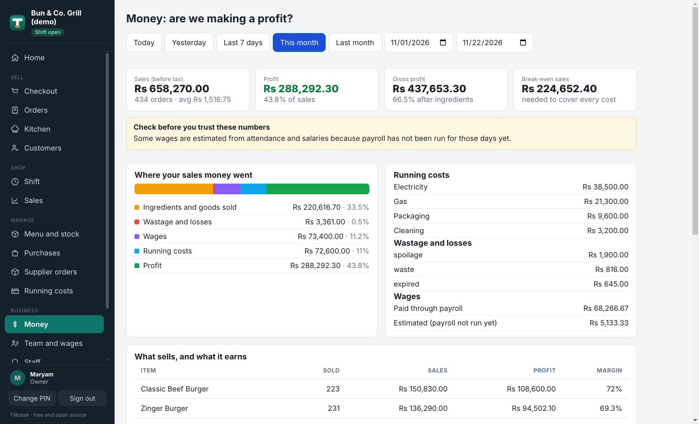
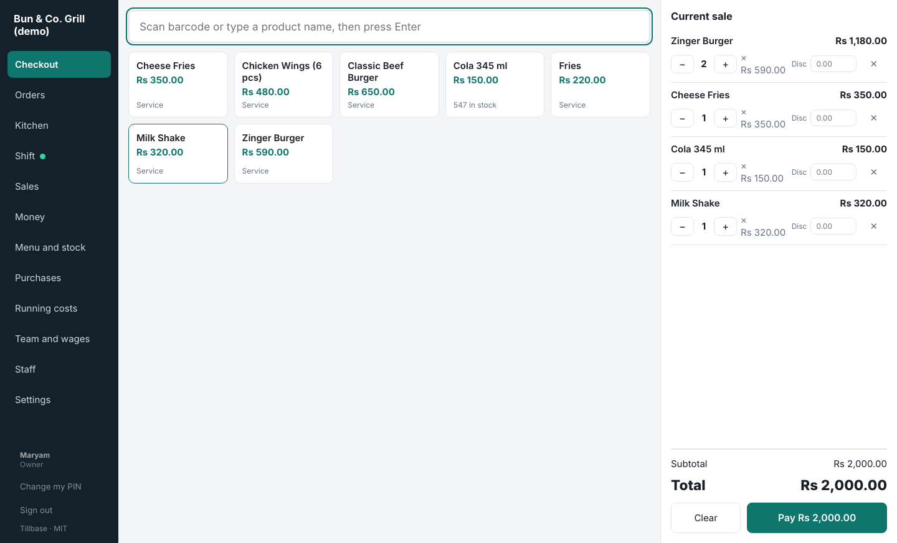
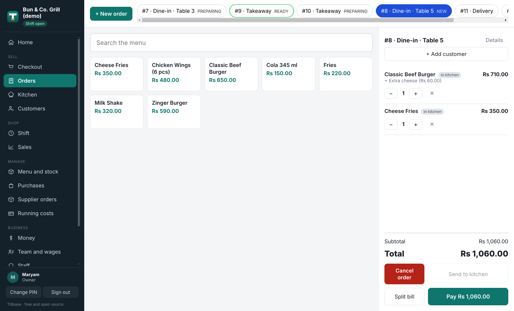
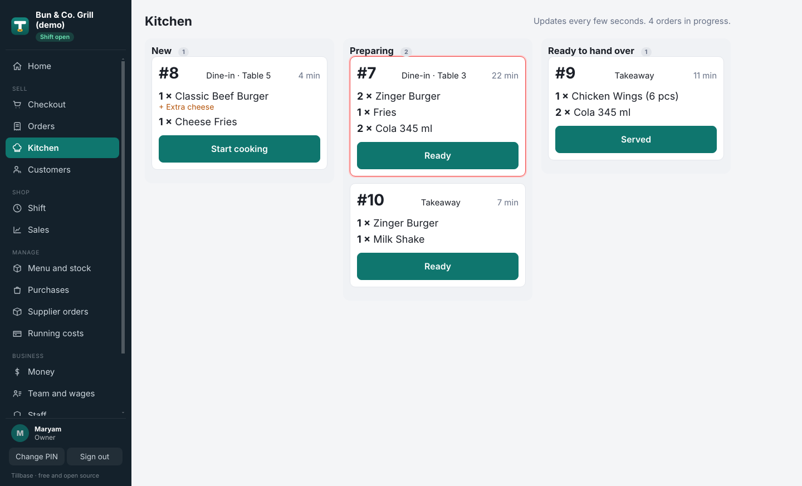

<div align="center">

# Tillbase

**The free, open-source business suite for shops, restaurants and fast-food outlets.**<br>
Sell. Cook. Stock. Pay staff. Know if you are making money.<br>
No subscription. No per-user fees. No internet needed.

[](https://github.com/mrbrown098/tillbase/actions/workflows/ci.yml)
[](LICENSE)
[](https://github.com/mrbrown098/tillbase/releases)


[**Download**](https://github.com/mrbrown098/tillbase/releases) &nbsp;·&nbsp; [Why Tillbase](#why-tillbase) &nbsp;·&nbsp; [What it does](#what-it-does) &nbsp;·&nbsp; [Compare](docs/COMPARISON.md) &nbsp;·&nbsp; [Roadmap](#roadmap) &nbsp;·&nbsp; [Support the project](#support-the-project)



</div>

> **Status: early development (v0.4).** Everything listed under "What it does" is built and tested. **Tillbase is not yet approved for FBR, PRA or SRB tax-authority integration.** Do not rely on it for tax filing until that exists.

## Why Tillbase

Paid POS systems charge every month for a till, a few reports and the right to keep your own data. Tillbase gives a shop the same daily tools, plus the one thing most of them skip: an honest answer to *"am I making money, and where is it going?"*

| | |
|---|---|
| **Truly free** | MIT licensed. No subscription, no setup fee, no limit on terminals, staff or items. Nothing is locked behind a paid tier. |
| **A whole business suite** | Checkout, restaurant orders and kitchen, recipes and real food cost, purchases and suppliers, running costs, wages, profit and loss. |
| **Any kind of shop** | Grocery, clothes, pharmacy, cafe or fast food: one engine. Retail uses checkout and stock; food adds recipes, orders and the kitchen. |
| **Your data is yours** | One SQLite file on your own computer with automatic backups. No account, no cloud, no one else reading your sales. |
| **Works offline** | An internet outage never stops a sale. |
| **Numbers you can trust** | Money is whole paisa or cents, never decimals that drift. Stock is a log, never an overwritten number. A sale is one database transaction. If a figure may be wrong, the screen says so. |
| **Built to be checked** | Hundreds of automated tests, and every screen is driven in a real Electron window on Windows, macOS and Linux for each change. |

See an honest side-by-side with other free and paid systems in **[docs/COMPARISON.md](docs/COMPARISON.md)**.

## Download

1. Open the [Releases page](https://github.com/mrbrown098/tillbase/releases) and download the file for your computer: `.exe` (Windows), `.dmg` (macOS), `.AppImage` or `.deb` (Linux).
2. Each release lists SHA-256 checksums so you can check the download.
3. The installers are not code-signed yet (signing certificates cost money, see [Support the project](#support-the-project)). Windows shows "unknown publisher": choose **More info, then Run anyway**. On macOS, right-click the app and choose **Open** the first time.

Prefer to build it yourself? See [Quick start](#quick-start).

## What it does

**Selling**

<p>
  
  
  
</p>

- **Checkout** for counter sales: scan a barcode or search, change quantities, line discounts, tax, cash or card, change due, receipts for 58mm and 80mm printers. **Split payments:** one sale can be paid with cash, card and other together (the screen shows what is remaining, and change only comes out of cash). Exact cash or card is still one tap.
- **Orders** for fast-food and restaurants: a token number that restarts each day, dine-in, takeaway and delivery, table or customer details, add-ons such as extra cheese (with their own price and ingredient cost), several orders held open at once, paid in one tap. Delivery orders can carry a delivery charge, which is shown before payment and counted as income. A dine-in group can **split the bill by items** into separate bills, each with its own token, and pay separately. Every edit is saved immediately.
- **Kitchen** board and tickets: only new items are sent; orders move new, preparing, ready, served; late orders turn red. Only a manager can change or cancel food already in the kitchen.
- **Sales:** today's totals by payment method, top products, recent sales, reprint, void (stock is restored exactly).

**Knowing your numbers**

<p>
  
</p>

*The pictures are real screenshots of a made-up demo shop, taken by `npm run screenshots`.*

- **Menu and stock:** menu items and ingredients with units. A recipe gives each dish a real cost from what you actually paid (weighted-average cost), and selling a dish uses up its ingredients. Food-cost percentage and margin per item. Low-stock warnings.
- **Purchases:** record what you buy and what you still owe each supplier, and pay it down later.
- **Running costs:** rent, electricity, gas and more, in categories you can extend. Wastage (waste, spoilage, expiry, damage) is valued at cost.
- **Team and wages:** clock in and out; monthly, daily or hourly pay with overtime; advances recovered at payroll; payslips paid from the till drawer if you like.
- **Money (owner only):** profit or loss, where every rupee of sales went (ingredients, waste, wages, running costs, profit), break-even sales, per-item margins, busy hours, stock value and what you owe.
- **Import / export** of the menu as CSV, with a preview of every change before anything is saved ([guide](docs/csv-import-export.md)).

**Running the shop safely**
- **Staff and roles:** PIN login with owner, manager and cashier roles. Permissions are enforced in the app's main process, not just hidden in the screen. PINs are salted hashes, wrong PINs lock the account for 30 seconds, and the till signs out after 5 idle minutes. Profit and payroll are owner-only.
- **Shifts:** open with a cash float, record cash in and out, count the drawer blind at close, see short, over or exact. Business payments taken from the drawer are counted.
- **Backups:** a daily copy of your data, and another after each shift closes. The newest 14 are kept next to the database.
- **Settings:** store name, currency, number format, receipt width and footer.

## Quick start

Requires **Node.js 22 or newer** (check with `node --version`; Node 20 is end-of-life and the SQLite module no longer ships ready-made binaries for it). Ready-made installers for Windows, macOS and Linux are attached to each [release](../../releases); the steps below run it from source.

```bash
git clone https://github.com/mrbrown098/tillbase.git
cd tillbase
npm install
npm run app        # prepares SQLite for Electron, builds everything, opens the app
```

The first run takes a minute, then Tillbase asks you to create the owner account. If it does not start, see [docs/TROUBLESHOOTING.md](docs/TROUBLESHOOTING.md).

### Running the tests

SQLite is a native module, and Electron and plain Node need different builds of it. `npm run app` prepares the Electron build. Switch back to the Node build before running tests:

```bash
npm run rebuild:node
npm test
npm run typecheck
```

### Using the core engine on its own

`@tillbase/core` has no UI and can be used from any Node program:

```ts
import { openDatabase, ProductService, InventoryService, SaleService, formatReceipt } from "@tillbase/core";

const db = openDatabase("shop.sqlite");
const products = new ProductService(db);
const inventory = new InventoryService(db);
const sales = new SaleService(db, "T1");

const milk = products.create({ name: "Milk 1L", priceMinor: 250, barcode: "6001", taxRateBp: 1000 });
inventory.adjust(milk.id, 24, "purchase");

const sale = sales.checkout({
  lines: [{ productId: milk.id, qty: 2 }],
  payments: [{ method: "cash", amountMinor: 1000 }],
  cashier: "Ali",
});

console.log(formatReceipt(sale, { storeName: "Corner Shop" }));
```

Amounts are in minor units and tax rates in basis points: `1800` means 18.00%.

## Roadmap

**Shipped**
- [x] Checkout, barcode scanning, receipts (58 and 80 mm), split payments
- [x] Staff PIN logins, roles, shifts, blind cash-up
- [x] Ingredients, recipes, real food cost; purchases and what you owe; running costs; wastage
- [x] Attendance and payroll; profit and loss
- [x] Fast-food orders, add-ons, delivery fees, split bills, kitchen board
- [x] Menu CSV import and export; daily backups
- [x] Installers for Windows, macOS and Linux; tests on all three

**In review now** (open pull requests)
- [ ] Customers and loyalty (phone search, points, wallet)
- [ ] Accountant export (Excel-ready CSV files)
- [ ] Second-place backups and restore

**Next**
- [ ] First-run setup: country and currency, business mode, business-day cutoff
- [ ] Customer credit (khata): sell on account, record repayments
- [ ] Direct thermal printing and cash drawer; shift Z-report
- [ ] Supplier purchase orders
- [ ] Urdu interface and receipts
- [ ] Sponsor banners (clean, local, no tracking)
- [ ] Signed installers and auto-update
- [ ] Several terminals on one network, then multi-branch sync

Full detail in [docs/ROADMAP.md](docs/ROADMAP.md).

## Project layout

```
packages/
  core/        @tillbase/core: all business logic and the SQLite schema (TypeScript, no UI)
    src/         sales, orders, products, recipes, inventory, purchases, expenses, labour,
                 finance (profit and loss), users, shifts, permissions, csv, backup, migrations
    test/        vitest tests
  desktop/     @tillbase/desktop: Electron + React app that uses the core
    electron/    main process: handlers.ts (the API and permission checks), main.ts, preload.ts, files.ts
    shared/      api.ts: the interface between screens and the main process
    renderer/    React screens, one file per screen
    scripts/     rebuild-native.mjs (prepares SQLite for Electron)
    test/        API and permission tests
docs/
  ROADMAP.md           plan, market position, compliance note
  DEVELOPMENT.md       the rules and workflow for contributors (read this first)
  TROUBLESHOOTING.md   if the app will not start
  csv-import-export.md the menu CSV format
```

## Contributing

Tillbase is built to be worked on by several people at once, so the rules are written down.

1. Read **[docs/DEVELOPMENT.md](docs/DEVELOPMENT.md)**. It is short and covers the rules the code follows (money, migrations, stock, permissions) and how to avoid conflicts.
2. Pick something from "Being built right now" or "Up next", and open an issue saying you are taking it so two people do not build the same thing.
3. Work on a branch `feature/<name>` from the latest `main`. Never push to `main`.
4. Add tests (hand-check the numbers when money is involved) and run the real app for anything with a screen.
5. Run `npm run rebuild:node && npm test && npm run typecheck`, rebase on `main`, and open a pull request that says what you tested and what you did not.

Be honest in code and in the UI: do not claim tax-authority approval, and do not hide a number that might be wrong.

## Support the project

Tillbase has no company behind it and no investors. It runs on volunteer time and free tools. If it helps your shop, you can help it stay free:

- **Sponsor or donate:** see the *Sponsor* button at the top of this repository.
- **Sponsor a banner:** a small clearly labelled banner can run on a few non-critical screens (never checkout, payment or login). No tracking, no scripts, no adult, gambling or alcohol ads. Rules and how to apply will be in `ads/README.md` once banners ship (planned, **not in the app yet**).
- **Contribute:** code, translations (Urdu first), testing in a real shop, or bug reports all count.

Money raised goes first to a code-signing certificate (removes the "unknown publisher" warning), then a website and download hosting.

## License

[MIT](LICENSE). Free for personal and commercial use.
