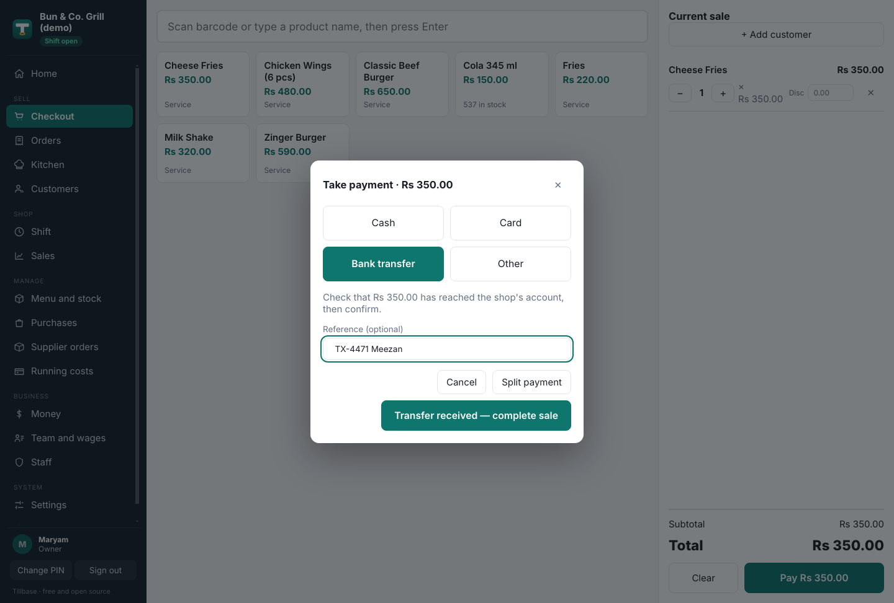
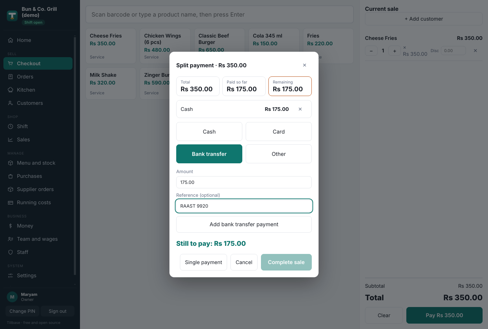

# Taking payment at the till

Press **Pay** on the checkout screen. The payment window offers four methods as large buttons:
**Cash**, **Card**, **Bank transfer** and **Other**.

## Bank transfer

1. Choose **Bank transfer**. The window asks you to check that the amount has reached the shop's account.
2. Optionally type a **Reference**: the transaction number or a short note (up to 80 characters).
3. Press **Transfer received — complete sale**.

The reference is saved with the payment. A bank transfer is never counted as cash in the drawer.

## Split payment

Press **Split payment** to pay one bill in parts, for example half in cash and the rest by bank transfer.

- Each part is added with its own method. A bank-transfer part can carry its own reference.
- The window always shows Total, Paid so far and Remaining, and says in words what is still needed.
- **Change can only be given from cash.** Card, bank transfer and other payments cannot be more than what is left to pay. If they are, the window says so and which amount to lower.

## Pressing twice

Each attempt to pay carries its own number. If **Complete sale** is pressed twice, or the answer is lost and the sale is sent again, the shop keeps one sale, not two.
